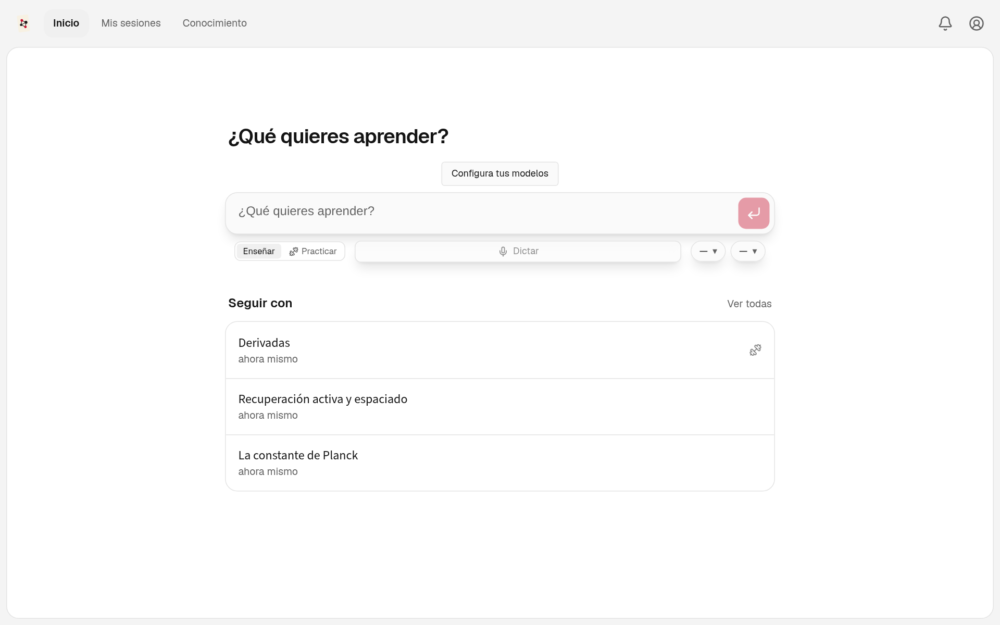
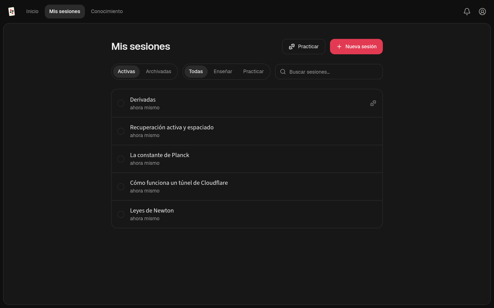

<p align="center">
  
</p>

<h1 align="center">Naipes</h1>

<p align="center"><strong>An AI-agent tutor that learns how you think.</strong></p>

<p align="center">
  <a href="README.md">Español</a> · <strong>English</strong>
</p>

<p align="center">
  <a href="https://github.com/alanahuel/naipes/releases">Download</a> ·
  <a href="#how-it-works">How it works</a> ·
  <a href="docs/development.md">Documentation</a> ·
  <a href="https://github.com/alanahuel/naipes/issues">Issues</a>
</p>

Naipes uses AI agents to plan and teach lessons from your current understanding to your goal. It builds a detailed picture of what you understand and how you reason, and updates that picture as you learn.

Instead of just giving you an explanation, it uses your answers and thinking to decide what you need next. Teaching builds understanding one reasoning step at a time, practice makes it usable, and a persistent knowledge graph carries it across sessions.

> Naipes is a derivative of **[LearnHarness](https://github.com/amosblomqvist/learnharness)** by Amos Blomqvist, released under the same AGPL-3.0 license. See [Credits](#credits-and-license).

<p align="center">
  
  
</p>

## What Naipes adds

- **Claude Code subscription as a provider.** Use the models in your Claude Code subscription through the local `claude` CLI, with no API key.
- **Two-way knowledge-folder connection.** Pick any folder of notes (an Obsidian vault or a plain folder): the subfolders you check feed the knowledge graph. It reads Markdown, text, PDF (with local OCR when Tesseract is installed), Word (.docx) and epub, and every idea remembers the page it came from. Transcripts, practice results, concepts and session summaries are written back to a configurable output folder, with standard Markdown links or, with the Obsidian format on, `[[wikilinks]]`. Details in [docs/obsidian.md](docs/obsidian.md).
- **Local Linux install.** `scripts/install-linux.sh` builds your checkout into an AppImage and installs it with a launcher and icon.
- **A redesigned interface:**
  - Home · My sessions · Knowledge tabs on a single sheet;
  - light and dark themes, or the system's;
  - the interface in Spanish and English;
  - each session's state at a glance ("Your turn", "Step 3 of 7");
  - session archiving;
  - a notifications bell for work that finishes in the background;
  - settings split into simple pages.
- **Its own identity:** name, card-graph icon, and releases from this repository.

## How it works

1. **Measure.** Before teaching, the agent finds where your understanding ends on each part the lesson depends on. Your answers, confidence, and thinking show it where to start.
2. **Plan.** It works out a dependency map from that starting point to your goal. You can see the plan, and the lesson adapts when your understanding turns out different.
3. **Teach.** Each step builds on something you already understand. You predict, get an explanation, and check your understanding. Confusions are repaired before anything is built on them. The aim is for the goal to feel obviously true, not merely familiar.
4. **Practice.** Separate sessions pose varied problems that require the right knowledge to come to mind without being named first. Problems and hints adapt to your reasoning.

**Think out loud.** The thinking fields let you explain your reasoning, uncertainties, and reactions in your own words. This gives the agent a detailed picture rather than just a record of right and wrong answers. You can type or use dictation.

The agent can also research questions in the background, create visual explanations, and build interactive demonstrations.

## Knowledge that carries forward

What you are taught accumulates as propositions and reasoning chains: individual claims and the premises that lead to them. The graph shows this structure, with links back to the source sessions. You can also import notes or connect your knowledge folder (an Obsidian vault, for example).

Future teaching sessions can read the graph instead of starting from scratch, and practice sessions can draw their material from it. It stores the ideas and their connections, not ratings of your ability.

## Install

Download the latest version from **[GitHub Releases](https://github.com/alanahuel/naipes/releases)**:

- **Linux (x64):** make the AppImage executable and open it, or install the Debian/Ubuntu `.deb`.
- **Windows (x64):** run the installer. It is unsigned, so Windows may show a SmartScreen or "unknown publisher" warning.
- **macOS (Apple Silicon):** drag the app to Applications. It is unsigned and not notarized: the first time, open it with right-click → Open. On macOS, download updates manually.

To build and install your own checkout on Linux:

```bash
bash scripts/install-linux.sh
```

Add your provider API key (or connect a subscription) and choose your models, then start a session with what you want to understand. Over 30 providers are available, including OpenAI, Anthropic, Google, DeepSeek, and OpenRouter. Optional dictation and web search use separate service keys.

**Dictation:** create a [Deepgram API key](https://console.deepgram.com/) with the **Member role or higher** ([required for token minting](https://developers.deepgram.com/reference/auth/tokens/grant)) and add it under **Settings → Providers → Dictation**. Choose the language below the key; **Multilingual** detects the language automatically and supports mixed-language speech.

## Your keys, your data

- **Your keys and models.** No Naipes subscription or markup. You pay your providers for usage; a live cost meter shows model costs.
- **Local storage.** Your chats, graph, settings, and API keys live on your machine. Learning records are plain files you can inspect.
- **External services.** Models run through your configured providers. Model requests send the context needed for the task; web research and dictation also contact external services. Local storage does not mean offline processing.
- **Inspectable behavior.** System prompts are visible and editable.

## Development

```bash
pnpm install
pnpm run dev  # http://localhost:3000
pnpm test     # deterministic, no LLM, no network
```

See the [development guide](docs/development.md), [architecture](docs/architecture.md), and [desktop release guide](docs/desktop-release.md).

Questions, bug reports, and feature requests: [GitHub Issues](https://github.com/alanahuel/naipes/issues).

## Credits and license

Naipes builds on [LearnHarness](https://github.com/amosblomqvist/learnharness), created by **Amos Blomqvist** and contributors. The git history preserves their work. Naipes's changes (rename, Claude Code connection, Obsidian integration, Linux installer, visual identity, and the new interface) are in the later commits.

Licensed under the [GNU Affero General Public License v3.0](LICENSE), the same as the original.
