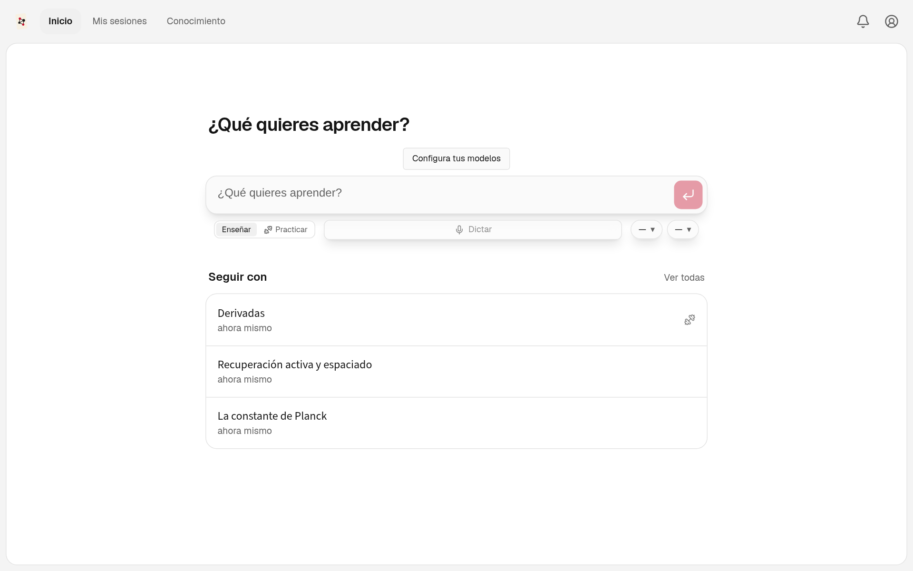
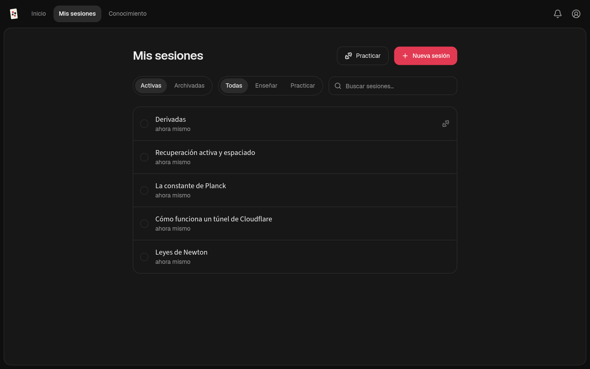

<p align="center">
  
</p>

<h1 align="center">Naipes</h1>

<p align="center"><strong>Un tutor con agentes de IA que aprende cómo piensas.</strong></p>

<p align="center">
  <strong>Español</strong> · <a href="README.en.md">English</a>
</p>

<p align="center">
  <a href="https://github.com/alanahuel/naipes/releases">Descargas</a> ·
  <a href="#cómo-funciona">Cómo funciona</a> ·
  <a href="docs/development.md">Documentación</a> ·
  <a href="https://github.com/alanahuel/naipes/issues">Issues</a>
</p>

Naipes usa agentes de IA para planificar y darte lecciones que van desde lo que ya entiendes hasta tu objetivo. Construye una imagen detallada de lo que comprendes y de cómo razonas, y la actualiza mientras aprendes.

En lugar de limitarse a explicarte algo, usa tus respuestas y tu forma de pensar para decidir qué necesitas a continuación. La enseñanza construye la comprensión paso a paso, la práctica la vuelve utilizable y un grafo de conocimiento persistente la conserva entre sesiones.

> Naipes es un derivado de **[LearnHarness](https://github.com/amosblomqvist/learnharness)**, de Amos Blomqvist, publicado bajo la misma licencia AGPL-3.0. Ver [Créditos](#créditos-y-licencia).

<p align="center">
  
  
</p>

## Qué añade Naipes

- **Suscripción de Claude Code como proveedor.** Usa los modelos de tu suscripción de Claude Code a través del CLI `claude` instalado en tu equipo, sin API key.
- **Conexión bidireccional con Obsidian.** Las carpetas que elijas de tu vault alimentan el grafo de conocimiento. Las transcripciones, las prácticas, los conceptos y los resúmenes de sesión se escriben de vuelta en una carpeta de salida configurable. Más detalles en [docs/obsidian.md](docs/obsidian.md).
- **Instalación local en Linux.** `scripts/install-linux.sh` compila tu copia del repositorio como AppImage y la instala con lanzador e icono.
- **Una interfaz rediseñada:**
  - pestañas Inicio · Mis sesiones · Conocimiento sobre una sola hoja;
  - tema claro y oscuro, o el del sistema;
  - la interfaz en español y en inglés;
  - el estado de cada sesión a la vista ("Te toca responder", "Paso 3 de 7");
  - archivar sesiones;
  - una campana de avisos para lo que termina en segundo plano;
  - los ajustes repartidos en páginas sencillas.
- **Identidad propia:** nombre, icono naipe-grafo y releases en este repositorio.

## Cómo funciona

1. **Medir.** Antes de enseñar, el agente averigua hasta dónde llega tu comprensión de cada parte de la que depende la lección. Tus respuestas, tu confianza y tu razonamiento le indican por dónde empezar.
2. **Planificar.** Traza un mapa de dependencias desde ese punto de partida hasta tu objetivo. Puedes ver el plan, y la lección se adapta cuando tu comprensión resulta ser distinta de lo esperado.
3. **Enseñar.** Cada paso se apoya en algo que ya entiendes: predices, recibes una explicación y compruebas que lo has entendido. Las confusiones se reparan antes de construir nada encima. El objetivo es que la meta te parezca evidente, no solo familiar.
4. **Practicar.** En sesiones aparte se plantean problemas variados que exigen recordar el conocimiento adecuado sin que nadie lo nombre antes. Los problemas y las pistas se adaptan a tu razonamiento.

**Piensa en voz alta.** Los campos de razonamiento te dejan explicar con tus palabras lo que piensas, tus dudas y tus reacciones. Así el agente obtiene una imagen detallada, no solo un registro de aciertos y fallos. Puedes escribir o dictar.

El agente también puede investigar preguntas en segundo plano, crear explicaciones visuales y construir demostraciones interactivas.

## Conocimiento que se acumula

Lo que aprendes se acumula como proposiciones y cadenas de razonamiento: afirmaciones concretas y las premisas que llevan a ellas. El grafo muestra esa estructura, con enlaces a las sesiones de origen. También puedes importar notas o conectar tu vault de Obsidian.

Las sesiones futuras pueden leer el grafo en lugar de empezar de cero, y las de práctica pueden sacar de él su material. El grafo guarda ideas y conexiones, no puntuaciones de tu capacidad.

## Instalación

Descarga la última versión desde **[GitHub Releases](https://github.com/alanahuel/naipes/releases)**:

- **Linux (x64):** dale permisos de ejecución al AppImage y ábrelo, o instala el `.deb` en Debian/Ubuntu.
- **Windows (x64):** ejecuta el instalador. No está firmado, así que Windows puede mostrar un aviso de SmartScreen o de "editor desconocido".
- **macOS (Apple Silicon):** arrastra la app a Aplicaciones. No está firmada ni notarizada: la primera vez, ábrela con clic derecho → Abrir. En macOS las actualizaciones se descargan a mano.

Para compilar e instalar tu propia copia en Linux:

```bash
bash scripts/install-linux.sh
```

Añade la API key de tu proveedor (o conecta una suscripción) y elige tus modelos. Después empieza una sesión con lo que quieras entender. Hay más de 30 proveedores disponibles, entre ellos OpenAI, Anthropic, Google, DeepSeek y OpenRouter. El dictado y la búsqueda web opcionales usan claves de servicio aparte.

**Dictado:** crea una [API key de Deepgram](https://console.deepgram.com/) con **rol Member o superior** ([necesario para emitir tokens](https://developers.deepgram.com/reference/auth/tokens/grant)) y añádela en **Ajustes → Proveedores → Dictado**. Debajo de la clave eliges el idioma; **Multilingual** reconoce el idioma automáticamente y admite habla mezclada.

## Tus claves, tus datos

- **Tus claves y tus modelos.** Sin suscripción a Naipes ni comisiones. Pagas a tus proveedores por lo que uses, y un contador en vivo muestra el coste de los modelos.
- **Almacenamiento local.** Tus chats, el grafo, los ajustes y las API keys viven en tu equipo. Los registros de aprendizaje son archivos de texto plano que puedes inspeccionar.
- **Servicios externos.** Los modelos se ejecutan a través de los proveedores que configures. Cada petición envía el contexto necesario para la tarea, y la investigación web y el dictado también contactan con servicios externos. Que los datos se guarden en local no significa que el procesamiento sea offline.
- **Comportamiento inspeccionable.** Los prompts del sistema son visibles y editables.

## Desarrollo

```bash
pnpm install
pnpm run dev  # http://localhost:3000
pnpm test     # determinista, sin LLM ni red
```

Consulta la [guía de desarrollo](docs/development.md), la [arquitectura](docs/architecture.md) y la [guía de releases de escritorio](docs/desktop-release.md); la documentación técnica está en inglés.

Preguntas, errores y propuestas: [GitHub Issues](https://github.com/alanahuel/naipes/issues).

## Créditos y licencia

Naipes parte de [LearnHarness](https://github.com/amosblomqvist/learnharness), creado por **Amos Blomqvist** y sus colaboradores. El historial de git conserva su trabajo. Los cambios de Naipes (renombre, conexión con Claude Code, integración con Obsidian, instalador de Linux, identidad visual y nueva interfaz) están en los commits posteriores.

Se distribuye bajo la [GNU Affero General Public License v3.0](LICENSE), igual que el original.
